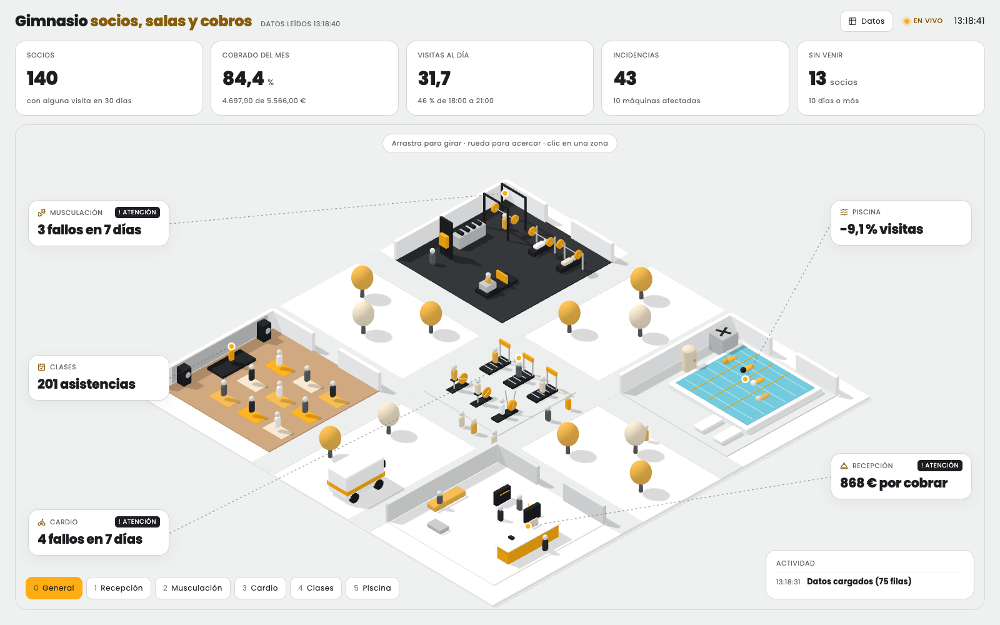

# tablero-3d

**Tu negocio como una maqueta 3D en la que haces clic en cada zona y ves sus números.** Los números salen de un CSV: lo editas, guardas y el tablero cambia solo. Si pones una zona en "parada", su máquina se detiene en el 3D.

Es una skill para Claude Code: le pasas tus datos y te construye la maqueta. Trae tres ejemplos: una tostadora de café, una tienda online y un gimnasio. Cada tablero puede llevar los colores, las tipografías y el logo de tu marca.


## Empieza

Necesitas [Node.js](https://nodejs.org/) 20 o más reciente y [Claude Code](https://claude.com/claude-code).

```bash
npx skills add annderson8/tablero-3d -g -a claude-code
```

Después, en Claude Code, desde la carpeta donde quieras crearlo:

```text
/tablero-3d ventas.xlsx
```

También vale un CSV, datos pegados en el chat o solo una descripción de tu negocio. Claude te pregunta lo que no pueda saber por tus datos, elige contigo qué números mirar, crea un proyecto nuevo y lo deja funcionando.

Luego puedes seguir pidiéndole cambios, también con `/tablero-3d`: *"usa los colores de mi marca"*, *"pon este logo"*, *"avísame cuando haya más de 5 pedidos tarde"*.

## Cómo se usa el tablero

- **Arrastra** para girar, **rueda** para acercar, **clic** en una zona para ver su panel. Teclas numéricas para saltar entre zonas y `Esc` para volver.
- Pulsa **Datos** (arriba a la derecha): verás todas las filas del CSV. Cambia una cifra o pon una zona en `parada` y el tablero responde al momento. El cambio se guarda en `datos/planta.csv`.
- O edita `datos/planta.csv` en Excel, Numbers o VS Code y guarda: en un par de segundos el tablero lo recoge.


## Probar un ejemplo sin Claude

| Tienda online, con marca naranja | Gimnasio, con marca amarilla |
| --- | --- |
|  |  |

```bash
git clone https://github.com/annderson8/tablero-3d.git
node tablero-3d/scripts/crear.mjs mi-tablero --ejemplo tienda   # o gimnasio, tostadora
cd mi-tablero
npm run dev
```

Para adaptarlo a mano, sigue los pasos 3 y 4 de [`SKILL.md`](SKILL.md).

## El archivo de datos

```
clave,valor,unidad,nota
tostado_estado,en marcha,,en marcha | atención | parada
tostado_temperatura,203,°C,Temperatura del tambor
almacen_stock,1340,bolsas,"Huila, Colombia"
```

Una fila por dato. Las claves empiezan por su zona. Las series van con punto y coma (`200;121;98;117`). Una fila `reparto_regla` con `reparto_tarde > 5 : atención` hace que la zona cambie sola. También acepta el `;` como separador de Excel en español. Las cifras de los ejemplos son inventadas.

## Cómo está hecho

| Carpeta | Qué hay |
| --- | --- |
| `SKILL.md`, `referencias/` | La skill y lo que consulta mientras trabaja |
| `scripts/crear.mjs` | Crea un proyecto nuevo a partir de la plantilla y un ejemplo |
| `plantilla/` | El tablero: cámara, tarjetas, paneles, gráficas, lectura del CSV, piezas 3D y `marca.json` con colores, tipografías y logo |
| `ejemplos/` | Cada negocio de ejemplo, con su mundo y su CSV |

Hecho con [Three.js](https://threejs.org/) y [React Three Fiber](https://r3f.docs.pmnd.rs/), servido con [Vite](https://vite.dev/). Todo se dibuja con código, sin modelos 3D.

`npm run build` deja una versión estática en `dist/` con una copia del CSV en ese momento. Ahí el panel **Datos** funciona, pero sin servidor no puede escribir el archivo: los cambios se quedan en la pestaña y el botón **CSV** te los descarga. Para guardar en el archivo, usa `npm run dev`.

El servidor de desarrollo solo acepta escribir `datos/planta.csv`, y solo existe en tu equipo mientras corre `npm run dev`.

## Licencia

MIT. Úsalo, cámbialo y publícalo, también con fines comerciales, conservando el aviso de licencia.

Hecho por [Annder Rey](https://annderrey.com) · [@annderrey](https://instagram.com/annderrey). Cómo se pensó: [Cómo hacer un dashboard 3D de tu negocio con Claude y un CSV](https://annderrey.com/blog/dashboard-3d-con-claude-y-tus-datos).

---

### English

**tablero-3d** turns a business into a clickable isometric 3D model whose numbers come from a CSV file: edit it, save, and the dashboard updates; set a zone to `parada` (stopped) and its machine freezes. It is a Claude Code skill: install it with `npx skills add annderson8/tablero-3d -g -a claude-code`, then run `/tablero-3d your-data.csv` to build your own world. Includes three examples (a coffee roastery, an online shop and a gym), and each dashboard can use your brand colors, fonts and logo. MIT licensed. The code and docs are in Spanish.
