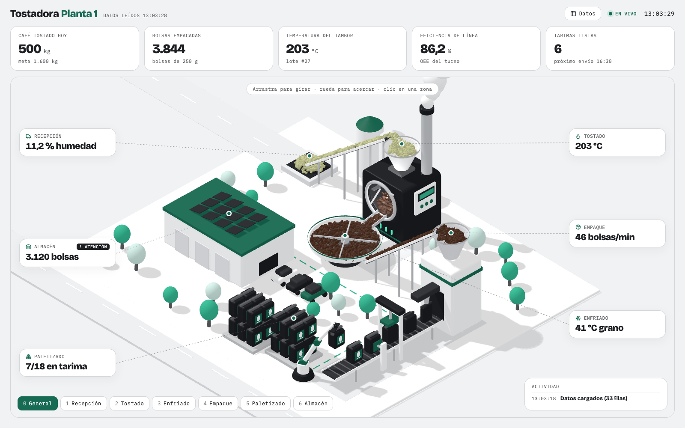
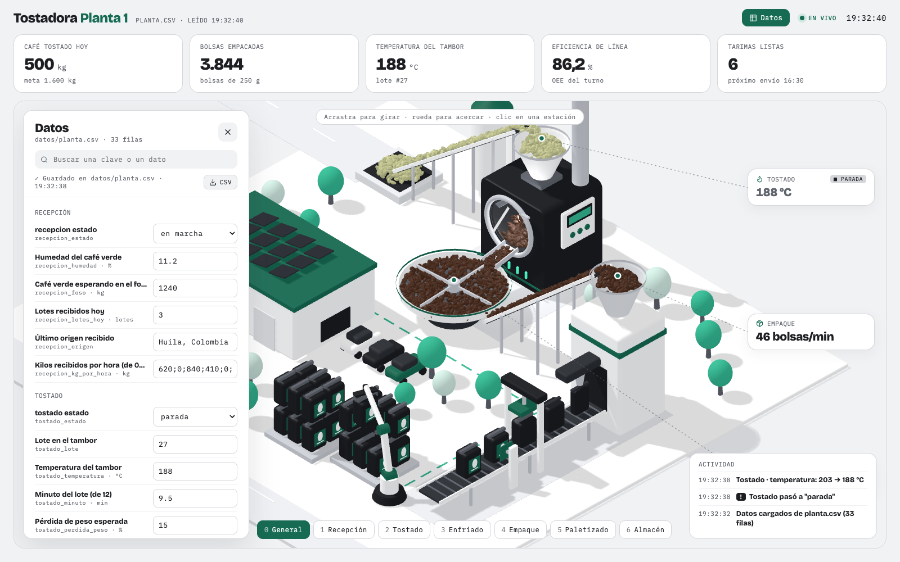
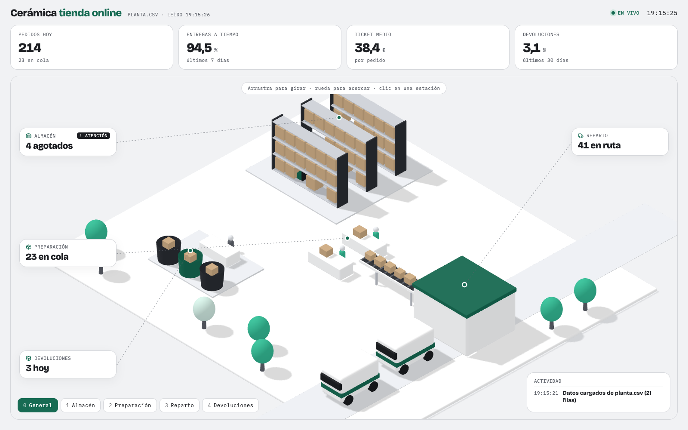

# tablero-3d

**Tu negocio como una maqueta 3D en la que haces clic en cada zona y ves sus números.** Los números salen de un CSV: lo editas, guardas y el tablero cambia solo. Si pones una zona en "parada", su máquina se detiene en el 3D.

Viene con dos ejemplos: una tostadora de café, del camión que trae el café verde hasta el almacén, y una tienda online con almacén, preparación, reparto y devoluciones.



## Pruébalo en dos minutos

Necesitas [Node.js](https://nodejs.org/) 20 o más reciente.

```bash
git clone https://github.com/annderson8/tablero-3d.git
cd tablero-3d
npm install
npm run dev
```

Abre la dirección que imprime (normalmente `http://localhost:5173`). Luego:

- **Arrastra** para girar, **rueda** para acercar, **clic** en una zona para ver su panel. Teclas `1`–`6` para saltar entre zonas y `Esc` para volver.
- Pulsa **Datos** (arriba a la derecha): verás todas las filas del CSV. Cambia una cifra o pon el tostado en `parada` y el tablero responde al momento. El cambio se guarda en `datos/planta.csv`.
- O edita `datos/planta.csv` en Excel, Numbers o VS Code y guarda: en un par de segundos el tablero lo recoge.



## Haz el tuyo

### Con Claude Code (recomendado)

El repo trae una skill que te entrevista sobre tu negocio, elige contigo qué números mirar, escribe tu CSV y construye tu mundo con las piezas del kit.

```bash
npx skills add annderson8/tablero-3d
```

Después, dentro de la carpeta del repo, pídele a Claude Code: *"haz el tablero 3D de mi negocio"*.

### Ver la tienda online



En `src/mundo.ts` cambia `tostadora` por `tienda` y copia `datos/ejemplos/tienda.csv` a `datos/planta.csv`.

### A mano

1. Copia `src/mundos/tienda/` (o `tostadora/`) a `src/mundos/<tu-negocio>/`.
2. Cambia zonas, indicadores y piezas en su `index.tsx` (el tipo `MundoTablero` en `src/mundos/tipos.ts` explica cada campo).
3. Pon tus datos en `datos/planta.csv` (formato en `skills/tablero-3d/referencias/csv.md`).
4. En `src/mundo.ts`, exporta tu mundo.

## El archivo de datos

```
clave,valor,unidad,nota
tostado_estado,en marcha,,en marcha | atención | parada
tostado_temperatura,203,°C,Temperatura del tambor
almacen_stock,1340,bolsas,"Huila, Colombia"
```

Una fila por dato. Las claves empiezan por su zona. Las series van con punto y coma (`200;121;98;117`). Las cifras de los ejemplos son inventadas; las copias originales están en `datos/ejemplos/`.

## Cómo está hecho

| Carpeta | Qué hay |
| --- | --- |
| `src/piezas/` | Formas, personas, árboles, furgonetas, cajas que circulan, colores y el reloj del mundo. Lo reutilizable |
| `src/tablero/` | Cámara, tarjetas flotantes, paneles, gráficas y lectura del CSV |
| `src/mundos/` | Cada negocio. `tostadora/` y `tienda/` son los ejemplos |
| `skills/tablero-3d/` | La skill para Claude Code y sus referencias |
| `datos/` | El CSV que lee el tablero |

Hecho con [Three.js](https://threejs.org/) y [React Three Fiber](https://r3f.docs.pmnd.rs/), servido con [Vite](https://vite.dev/). Todo se dibuja con código, sin modelos 3D.

`npm run build` deja una versión estática en `dist/` con una copia del CSV en ese momento. Ahí el panel **Datos** funciona, pero sin servidor no puede escribir el archivo: los cambios se quedan en la pestaña y el botón **CSV** te los descarga. Para guardar en el archivo, usa `npm run dev`.

El servidor de desarrollo solo acepta escribir `datos/planta.csv`, y solo existe en tu equipo mientras corre `npm run dev`.

## Licencia

MIT. Úsalo, cámbialo y publícalo, también con fines comerciales, conservando el aviso de licencia.

Hecho por [Annder Rey](https://annderrey.com) · [@annderrey](https://instagram.com/annderrey). Cómo se pensó: [Cómo hacer un dashboard 3D de tu negocio con Claude y un CSV](https://annderrey.com/blog/dashboard-3d-con-claude-y-tus-datos).

---

### English

**tablero-3d** turns a business into a clickable isometric 3D model whose numbers come from a CSV file: edit it, save, and the dashboard updates; set a zone to `parada` (stopped) and its machine freezes. Includes two examples (a coffee roastery and an online shop) and a Claude Code skill that interviews you about your business and builds your own world. `npm install && npm run dev` to try it. MIT licensed. The code and docs are in Spanish.
